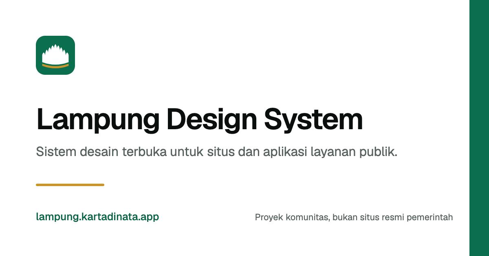

<p align="center">
  
</p>

<h1 align="center">Lampung Design System</h1>

<p align="center">
  An open design system for building public-service websites and apps quickly, with a consistent look.<br>
  <a href="https://lampung.kartadinata.app/en/">Website</a> ·
  <a href="https://lampung.kartadinata.app/docs/en/">Documentation</a> ·
  <a href="https://lampung.kartadinata.app/docs/examples/en/">Examples</a> ·
  <a href="README.md">Bahasa Indonesia</a>
</p>

<p align="center">
  <a href="https://www.npmjs.com/package/lampung-design-system"></a>
  <a href="https://www.npmjs.com/package/lampung-ds"></a>
  <a href="https://pub.dev/packages/lampung_design_system"></a>
  <a href="LICENSE"></a>
</p>

> **A community project, not an official product.** Lampung Design System (LDS) is built and maintained by an open source community. No government agency runs or endorses it.

## Why LDS

- **Quick to adopt.** One command sets up Next.js, Vite, TanStack Start, React Router, Astro, Laravel, plain HTML or Flutter.
- **Consistent.** One token file feeds CSS, JavaScript, shadcn/ui and Flutter. 179 components and recipes, each with guidance on when to use it and when not to.
- **For every resident.** WCAG 2.2 AA contrast computed for every color pair in light and dark, 44 px targets, keyboard support, reduced motion and forced colors.
- **Feels like Lampung.** Lampung green for action, siger gold for identity, and aksara Lampung (had Lampung) as a quiet accent.
- **Indonesian first.** Docs and examples in Indonesian, with English versions.

## Get started

```sh
npx lampung-ds@latest init
```

The CLI detects your framework, installs `lampung-design-system`, imports the CSS, marks `<html class="lds">` and turns on the interactive behaviors. Per-framework guides: [Installation](https://lampung.kartadinata.app/docs/en/guide/instalasi.html).

No install:

```html
<html lang="en" class="lds" data-theme="light">
<link rel="stylesheet" href="https://cdn.jsdelivr.net/npm/lampung-design-system@0/css/lds.css">

<button class="btn btn--primary">Send report</button>

<script type="module">
  import { init } from 'https://cdn.jsdelivr.net/npm/lampung-design-system@0/js/lds.js';
  init();
</script>
```

Flutter:

```sh
flutter pub add lampung_design_system
```

```dart
MaterialApp(theme: LdsTheme.light(), darkTheme: LdsTheme.dark(), home: const Home());
```

## What is in the repository

| Folder | Contents |
|---|---|
| `tokens/` | `tokens.json`, one source for color, type, space, radius, depth and motion |
| `css/` | `lds.css` (fonts, tokens and every component), importable in parts |
| `js/` | `lds.js`: interactive behaviors through `data-lds-*` attributes, including aksara Lampung |
| `react/` | React bindings for components whose state React owns |
| `aksara/` | Aksara Lampung glyphs (original drawings), SVG sprite and transliteration |
| `dist/` | Tokens for JS/TS and Flutter, the shadcn/ui theme and registry, the component registry for the CLI |
| `packages/cli/` | The `lampung-ds` CLI on npm |
| `packages/flutter/` | The `lampung_design_system` package on pub.dev |
| `apps/landing/` | The project home page |
| `docs/` | Documentation (Indonesian in `docs/`, English in `docs/en/`) and city service examples |
| `skills/` | Skills that teach AI agents to build interfaces with this system |

## Development

Requires Node.js 20 or newer, and Python 3 for the local server.

```sh
npm install
npm run build      # tokens, aksara, docs, examples
npm test           # every test suite
npm run serve      # http://localhost:5173
```

Contribution rules, including the commit format (Conventional Commits, small commits), are in [CONTRIBUTING.md](CONTRIBUTING.md) and [AGENTS.md](AGENTS.md).

## Partnerships

Want to use LDS for an agency, a city program or your product, or to work together? Write to **[alif@kartadinata.app](mailto:alif@kartadinata.app?subject=Lampung%20Design%20System%20partnership)**.

## License

[MIT](LICENSE). Solar icons (CC BY 4.0), Geist and Geist Mono (SIL OFL 1.1). Details in [NOTICE.md](NOTICE.md).
