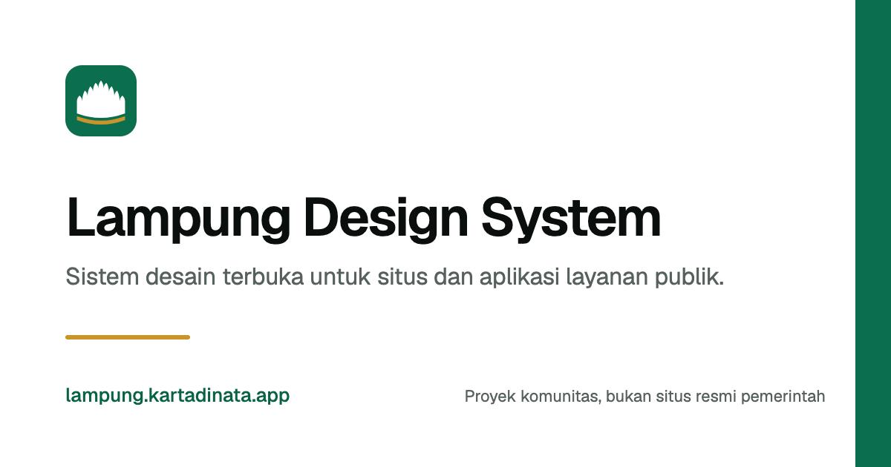
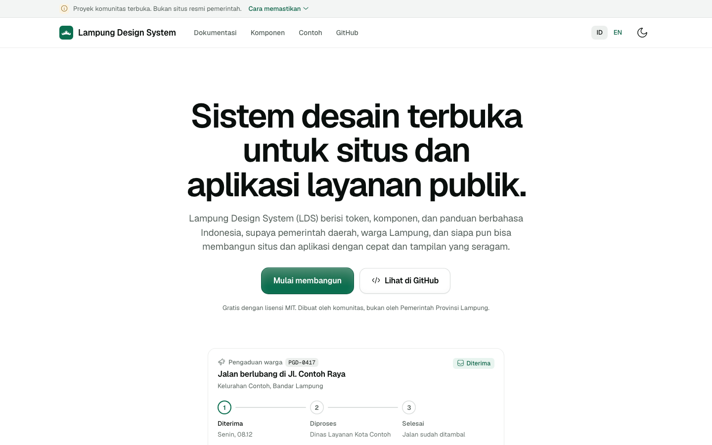
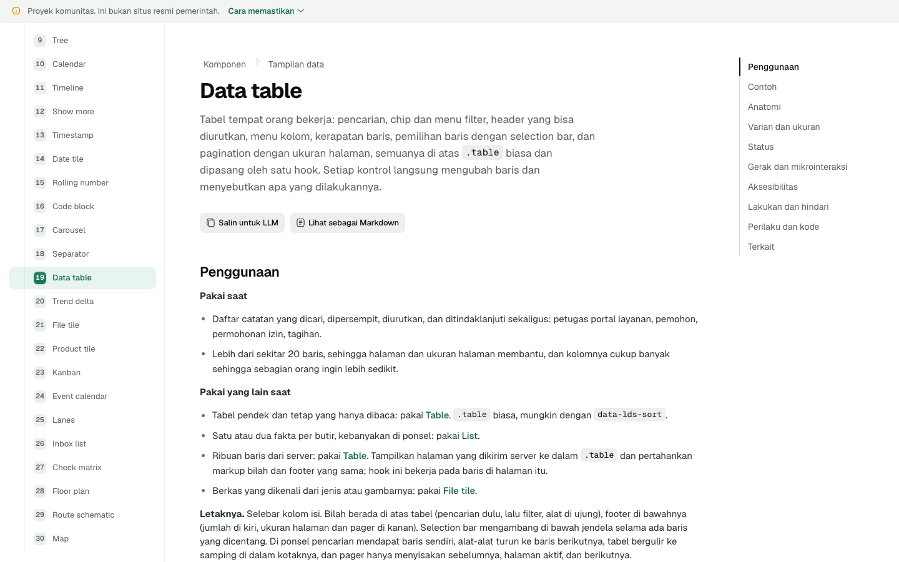
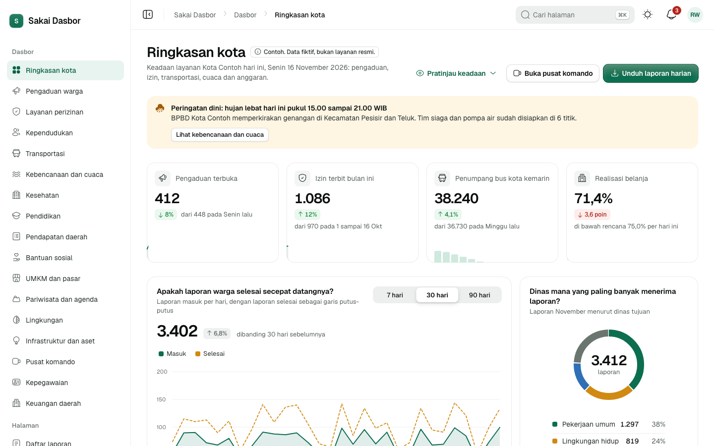
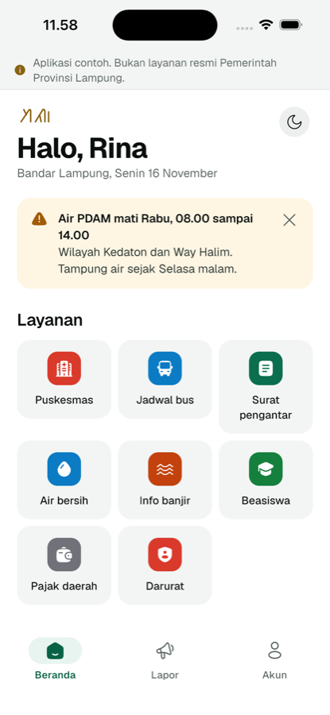
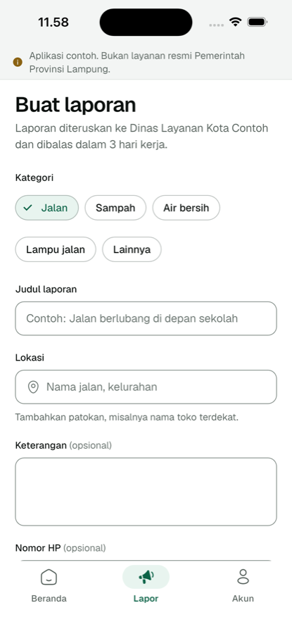
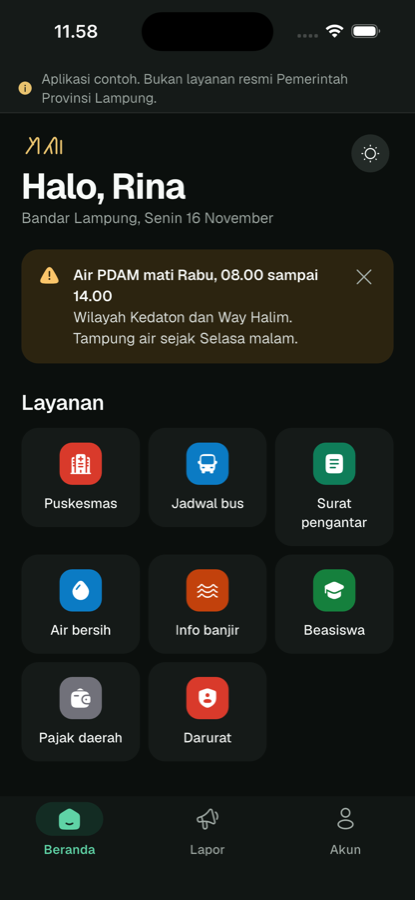
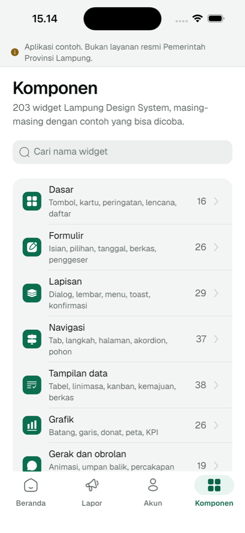

<p align="center">
  
</p>

<h1 align="center">Lampung Design System</h1>

<p align="center">
  Design system terbuka untuk membangun situs dan aplikasi layanan publik dengan cepat dan tampilan yang konsisten.<br>
  <a href="https://lampung.kartadinata.app">Situs</a> ·
  <a href="https://lampung.kartadinata.app/docs/">Dokumentasi</a> ·
  <a href="https://lampung.kartadinata.app/docs/examples/">Contoh</a> ·
  <a href="README.en.md">English</a>
</p>

<p align="center">
  <a href="https://www.npmjs.com/package/lampung-design-system"></a>
  <a href="https://www.npmjs.com/package/lampung-ds"></a>
  <a href="https://pub.dev/packages/lampung_design_system"></a>
  <a href="LICENSE"></a>
</p>

> **Proyek komunitas, bukan produk resmi.** Lampung Design System (LDS) dibuat dan dirawat komunitas open source. Tidak ada instansi pemerintah yang mengelola atau mendukungnya secara resmi.

## Pratinjau

### Situs web

<p align="center">
  
</p>

<table>
  <tr>
    <td width="50%"><br><sub>Dokumentasi komponen, lengkap dengan Salin untuk LLM</sub></td>
    <td width="50%"><br><sub>Contoh dasbor layanan kota (Sakai), dibangun hanya dari LDS</sub></td>
  </tr>
</table>

### Aplikasi Flutter (iPhone)

<table>
  <tr>
    <td align="center" width="25%"><br><sub>Beranda aplikasi warga</sub></td>
    <td align="center" width="25%"><br><sub>Formulir laporan warga</sub></td>
    <td align="center" width="25%"><br><sub>Mode gelap</sub></td>
    <td align="center" width="25%"><br><sub>Galeri 203 komponen di aplikasi contoh</sub></td>
  </tr>
</table>

Semua data di tangkapan layar adalah contoh. Coba langsung di [lampung.kartadinata.app](https://lampung.kartadinata.app) atau jalankan aplikasi Flutter di `packages/flutter/example`.

## Kenapa LDS

- **Cepat dipakai.** Satu perintah menyiapkan Next.js, Vite, TanStack Start, React Router, Astro, Laravel, HTML biasa, atau Flutter.
- **Konsisten.** Satu berkas token untuk CSS, JavaScript, shadcn/ui, dan Flutter. 179 komponen dan resep, masing-masing dengan panduan kapan dipakai dan kapan tidak.
- **Untuk semua warga.** Kontras WCAG 2.2 AA dihitung untuk setiap pasangan warna di mode terang dan gelap, target sentuh 44 px, keyboard, reduced motion, dan forced colors.
- **Terasa Lampung.** Hijau Lampung untuk aksi, emas siger untuk identitas, dan aksara Lampung (had Lampung) sebagai aksen yang tenang.
- **Bahasa Indonesia lebih dulu.** Dokumentasi dan contoh dalam bahasa Indonesia, dengan versi bahasa Inggris.

## Mulai

```sh
npx lampung-ds@latest init
```

CLI mengenali framework Anda, memasang `lampung-design-system`, mengimpor CSS, menandai `<html class="lds">`, dan menyalakan perilaku interaktif. Panduan per framework: [Instalasi](https://lampung.kartadinata.app/docs/guide/instalasi.html).

Tanpa instalasi:

```html
<html lang="id" class="lds" data-theme="light">
<link rel="stylesheet" href="https://cdn.jsdelivr.net/npm/lampung-design-system@0/css/lds.css">

<button class="btn btn--primary">Kirim laporan</button>

<script type="module">
  import { init } from 'https://cdn.jsdelivr.net/npm/lampung-design-system@0/js/lds.js';
  init();
</script>
```

Flutter:

```sh
flutter pub add lampung_design_system
```

```dart
MaterialApp(theme: LdsTheme.light(), darkTheme: LdsTheme.dark(), home: const Beranda());
```

## Isi repositori

| Folder | Isi |
|---|---|
| `tokens/` | `tokens.json`, satu sumber untuk warna, tipe, spasi, radius, kedalaman, dan gerak |
| `css/` | `lds.css` (font, token, dan semua komponen), bisa diimpor per bagian |
| `js/` | `lds.js`: perilaku interaktif lewat atribut `data-lds-*`, termasuk aksara Lampung |
| `react/` | Binding React untuk komponen yang state-nya dipegang React |
| `brand/` | Logo siger: `mark.svg` (ubin hijau), `siger.svg` (satu warna) |
| `aksara/` | Glyph aksara Lampung (gambar orisinal), sprite SVG, dan transliterasi |
| `dist/` | Token untuk JS/TS dan Flutter, tema dan registry shadcn/ui, registry komponen untuk CLI |
| `packages/cli/` | CLI `lampung-ds` di npm |
| `packages/flutter/` | Paket `lampung_design_system` di pub.dev |
| `apps/landing/` | Halaman depan proyek |
| `docs/` | Dokumentasi (Indonesia di `docs/`, Inggris di `docs/en/`) dan contoh layanan kota |
| `skills/` | Skill untuk agen AI agar membangun antarmuka sesuai sistem ini |

## Pengembangan

Butuh Node.js 20 atau lebih baru, dan Python 3 untuk server lokal.

```sh
npm install
npm run build      # token, aksara, dokumentasi, contoh
npm test           # semua pengujian
npm run serve      # http://localhost:5173
```

Aturan kontribusi, termasuk format commit (Conventional Commits, commit kecil), ada di [CONTRIBUTING.md](CONTRIBUTING.md) dan [AGENTS.md](AGENTS.md).

## Kerja sama

Ingin memakai LDS untuk instansi, program kota, atau produk Anda, atau ingin bekerja sama? Tulis ke **[alif@kartadinata.app](mailto:alif@kartadinata.app?subject=Kerja%20sama%20Lampung%20Design%20System)**.

## Lisensi

[MIT](LICENSE). Ikon Solar (CC BY 4.0), Geist dan Geist Mono (SIL OFL 1.1). Rincian di [NOTICE.md](NOTICE.md).
